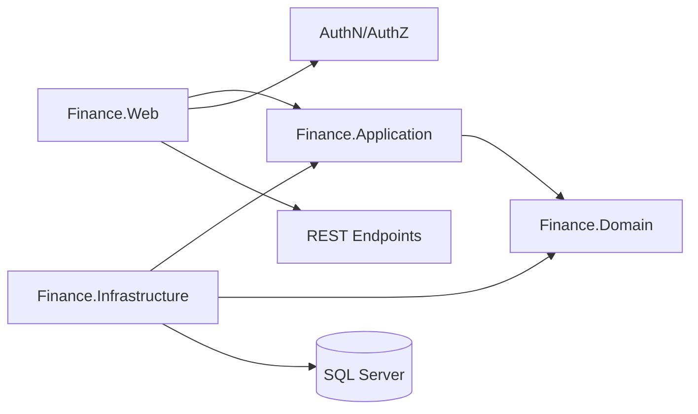

# Use Cases et architecture cible
## Migration WinForms vers Web .NET 8 avec DDD + Clean Architecture

Date: 2026-05-29

## 1. Bounded Contexts proposes
1. Identite et Acces
- Gestion des utilisateurs
- Authentification
- Gestion des droits d acces par module/journal

2. Tresorerie Mouvements
- Saisie caisse et banque
- Validation, devalidation, suppression controlee
- Calcul et controle des soldes

3. Parametrage
- Taux de change
- Journaux, documents, periodes, modeles
- Signataires et parametres de sortie

4. Reporting
- Rapport caisse
- Rapport banque
- Releve et etats financiers
- Exports PDF/Excel

## 2. Catalogue des use cases (sortie exploitable)
### 2.1 Identite et Acces
UC-IA-01: Authentifier un utilisateur
- Acteur: Utilisateur
- Entree: identifiant, mot de passe
- Regles:
  - Mot de passe hache et compare de maniere securisee
  - Compte actif uniquement
- Sortie:
  - Jeton de session
  - Profil utilisateur (centre de frais, niveau acces)
  - Permissions chargees

UC-IA-02: Creer un utilisateur
- Acteur: Administrateur
- Entree: matricule, nom, mot de passe initial, niveau acces, centre de frais
- Regles:
  - Unicite identifiant/matricule
  - Mot de passe conforme a la politique
- Sortie: utilisateur cree

UC-IA-03: Modifier un utilisateur
- Acteur: Administrateur
- Entree: utilisateur cible + champs modifies
- Sortie: utilisateur mis a jour

UC-IA-04: Supprimer/desactiver un utilisateur
- Acteur: Administrateur
- Regles: suppression logique recommandee
- Sortie: utilisateur desactive

UC-IA-05: Attribuer droits modules
- Acteur: Administrateur
- Entree: utilisateur, liste modules
- Sortie: permissions mises a jour

UC-IA-06: Attribuer journaux a un utilisateur
- Acteur: Administrateur
- Entree: utilisateur, liste journaux
- Sortie: affectations enregistrees

### 2.2 Tresorerie Mouvements
UC-TM-01: Ouvrir une session de saisie
- Acteur: Caissier/Comptable
- Entree: journal, date mouvement
- Regles:
  - Date dans exercice actif
  - Controle droit journal
- Sortie: contexte de saisie initialise

UC-TM-02: Saisir un mouvement (recette/depense)
- Acteur: Caissier/Comptable
- Entree: journal, document, compte, sens, montant, taux, beneficiaire/payeur, references
- Regles:
  - Champs obligatoires selon type mouvement
  - Verifications periode/modeles selon type recette
  - Controle coherence devise/taux
- Sortie: mouvement cree en statut Brouillon

UC-TM-03: Modifier un mouvement brouillon
- Acteur: Caissier/Comptable
- Regles: uniquement brouillon
- Sortie: mouvement modifie

UC-TM-04: Supprimer un mouvement brouillon
- Acteur: Caissier/Comptable
- Regles: uniquement brouillon, motif obligatoire
- Sortie: mouvement supprime + trace audit

UC-TM-05: Valider les mouvements du jour
- Acteur: Responsable/Controleur
- Entree: journal, date
- Regles:
  - Verification soldes
  - Verification pieces
- Sortie: mouvements passes a Valide

UC-TM-06: Devalider un mouvement
- Acteur: Profil autorise
- Regles: justifier la devalidation, traquer utilisateur/date
- Sortie: mouvement retourne Brouillon + audit

UC-TM-07: Calculer report et solde
- Acteur: Systeme
- Entree: journal, date
- Sortie: report, total recettes, total depenses, solde courant

UC-TM-08: Synchroniser paiement titre budget (si applicable)
- Acteur: Systeme
- Entree: numero titre, centre gestion
- Sortie: montant paye mis a jour dans budget

### 2.3 Parametrage
UC-PA-01: Gerer taux de change
- Acteur: Administrateur fonctionnel
- Entree: date, monnaie, montant taux
- Regles: unicite par date+monnaie
- Sortie: taux cree/modifie/supprime

UC-PA-02: Lister monnaies
- Acteur: Utilisateur autorise
- Sortie: catalogue monnaies

UC-PA-03: Lister journaux accessibles
- Acteur: Utilisateur
- Entree: centre de frais, profil
- Sortie: journaux autorises

UC-PA-04: Gerer signataires de rapport
- Acteur: Administrateur
- Entree: journal + signataires
- Sortie: signataires mis a jour

### 2.4 Reporting
UC-RP-01: Generer rapport caisse
- Acteur: Comptable/Controleur
- Entree: journal, periode, centre de frais
- Sortie: rapport (web + PDF)

UC-RP-02: Generer rapport banque
- Acteur: Comptable/Controleur
- Entree: journal, periode, centre de frais
- Sortie: rapport (web + PDF)

UC-RP-03: Generer releve des mouvements
- Acteur: Comptable/Controleur
- Entree: date debut, date fin, journal
- Sortie: releve detaille

UC-RP-04: Exporter en Excel
- Acteur: Utilisateur autorise
- Entree: dataset de rapport
- Sortie: fichier XLSX (generation serveur)

## 3. Architecture DDD + Clean cible
## 3.1 Vue d ensemble
Architecture en couches concentriques:
- Domain: coeur metier pur
- Application: orchestration des cas d usage
- Infrastructure: SQL, fichiers, providers externes
- Web: API REST + interface web

Regle de dependance:
- Web depend de Application
- Infrastructure depend de Application (ports) et Domain
- Application depend de Domain
- Domain ne depend d aucune couche externe

## 3.2 Organisation solution recommandee
- src/Finance.Domain
  - Aggregates
  - Entities
  - ValueObjects
  - DomainServices
  - DomainEvents
- src/Finance.Application
  - UseCases/Commands
  - UseCases/Queries
  - DTOs
  - Validators
  - Interfaces (ports)
- src/Finance.Infrastructure
  - Persistence (EF Core/Dapper)
  - Repositories
  - QueryServices
  - Security (password hasher, token)
  - Reporting (PDF/Excel)
- src/Finance.Web
  - Controllers ou Minimal APIs
  - Authentication/Authorization
  - DependencyInjection
  - UI (Razor/Blazor/SPA)
- tests/Finance.Domain.Tests
- tests/Finance.Application.Tests
- tests/Finance.IntegrationTests

## 3.3 Modeles DDD (exemple)
Aggregates principaux:
- UtilisateurAggregate
  - UtilisateurId, Identifiant, MotDePasseHash, NiveauAcces, CentreFrais
  - Comportements: ChangerMotDePasse, AttribuerDroit, RetirerDroit

- JournalAggregate
  - JournalId, CentreFraisId, TypeJournal
  - Comportements: AssignerUtilisateur, RetirerUtilisateur

- MouvementAggregate
  - MouvementId, JournalId, DateMouvement, Sens, Montant, Taux, Statut
  - Comportements: CreerBrouillon, Valider, Devalider, SupprimerBrouillon

- TauxAggregate
  - TauxId, Date, Monnaie, Valeur
  - Comportements: Creer, Modifier

Value Objects proposes:
- Money (Montant, Devise)
- Exercice
- CentreFraisCode
- NumeroDocument

## 3.4 Use cases -> Application layer (exemples de handlers)
- AuthenticateUserCommandHandler
- CreateUserCommandHandler
- AssignUserModulesCommandHandler
- StartEntrySessionCommandHandler
- CreateMovementCommandHandler
- ValidateDayMovementsCommandHandler
- RevertMovementValidationCommandHandler
- UpdateExchangeRateCommandHandler
- GenerateCashReportQueryHandler
- ExportBankReportExcelQueryHandler

## 3.5 Infrastructure
- ORM mixte recommande:
  - EF Core pour ecriture metier et transactions
  - Dapper pour lectures complexes/rapports
- Base SQL Server
- Requetes toujours parametrees
- Secret management externe (pas de secret en code)

## 3.6 Securite
- Authentification: JWT ou Cookie selon front
- Autorisation: policy-based + permissions metier
- Mot de passe: Argon2/PBKDF2/Bcrypt
- Journal d audit obligatoire:
  - Connexion
  - Echec authentification
  - Validation/devalidation
  - Suppression mouvement

## 3.7 Reporting web cible
- Sortie ecran: tableaux pagines + filtres
- Sortie PDF: generation serveur
- Sortie Excel: XLSX via librairie serveur (ex: ClosedXML)
- Plus d automation Excel Desktop cote serveur

## 4. Diagramme logique

## 5. Roadmap d implementation orientee use cases
Sprint 1
- UC-IA-01, UC-IA-02, UC-IA-05
- Mise en place socle Clean, auth, audit

Sprint 2
- UC-TM-01, UC-TM-02, UC-TM-03, UC-TM-07
- Ecran web de saisie mouvements v1

Sprint 3
- UC-TM-05, UC-TM-06, UC-PA-01
- Validation/devalidation + gestion taux

Sprint 4
- UC-RP-01, UC-RP-02, UC-RP-04
- Rapports et exports

## 6. Definition of Done minimale
- Regles metier couvertes par tests unitaires Application/Domain
- Zero SQL concatene dans la nouvelle base de code
- Endpoints securises par policies
- Traçabilite audit active sur cas sensibles
- Equivalence fonctionnelle validee avec utilisateurs metier

## 7. Specifications detaillees des use cases critiques

### 7.1 UC-IA-01 Authentifier un utilisateur (detail)
Pre-conditions:
- Utilisateur existe en base
- Compte actif (non desactive, non verrouille)

Flux nominal:
1. L utilisateur soumet identifiant + mot de passe
2. Le systeme recupere l utilisateur par identifiant
3. Le systeme verifie le hash du mot de passe
4. Le systeme charge le profil (centre de frais, niveau acces)
5. Le systeme charge les permissions (modules + journaux)
6. Le systeme emet un jeton (JWT) avec claims minimaux
7. Le systeme journalise la connexion reussie

Flux alternatifs:
- A1 Identifiant inconnu -> reponse generique "identifiants invalides" + audit echec
- A2 Mot de passe invalide -> incrementer compteur d echecs + audit
- A3 Compte verrouille -> reponse "compte verrouille" + audit
- A4 Compte desactive -> reponse "compte inactif" + audit

Regles de securite:
- Reponse identique pour identifiant inconnu et mot de passe faux (anti enumeration)
- Verrouillage temporaire apres N echecs consecutifs
- Pas de message detaille en clair sur la cause de l echec

Donnees de sortie:
- access_token (court terme)
- refresh_token (si applicable)
- profil utilisateur minimal
- liste des permissions effectives

### 7.2 UC-TM-02 Saisir un mouvement (detail)
Pre-conditions:
- Session de saisie ouverte (UC-TM-01)
- Utilisateur autorise sur le journal
- Periode ouverte

Flux nominal:
1. L utilisateur saisit les champs du mouvement
2. Le systeme valide les regles metier
3. Le systeme calcule le montant en devise de reference si applicable
4. Le systeme cree le mouvement en statut Brouillon
5. Le systeme retourne le mouvement cree + nouvel etat du solde

Regles metier:
- Montant > 0
- Sens dans {Recette, Depense}
- Si devise etrangere: taux obligatoire et coherent avec UC-PA-01
- Compte comptable existant et actif
- Document de reference unique par journal/exercice si requis
- Si type recette controle: verification modele/periode

Flux alternatifs:
- A1 Champ obligatoire manquant -> erreur 400 + liste champs
- A2 Periode fermee -> erreur 409 metier
- A3 Devise inconnue ou taux absent -> erreur 422
- A4 Document deja utilise -> erreur 409 metier

Sortie:
- MouvementDto avec Id, Statut=Brouillon, MontantBase, NumeroDocument

### 7.3 UC-TM-05 Valider les mouvements du jour (detail)
Pre-conditions:
- Utilisateur a le droit de validation sur le journal
- Au moins un mouvement en Brouillon pour la date

Flux nominal:
1. Le systeme recupere les mouvements Brouillon du journal+date
2. Le systeme verifie:
   - Coherence des soldes
   - Presence des pieces obligatoires
   - Coherence devise/taux
3. Le systeme passe chaque mouvement en statut Valide
4. Le systeme journalise (audit) la validation: qui, quand, combien
5. Le systeme renvoie un resume (nb valides, nb rejetes, motifs)

Regles:
- Operation transactionnelle (tout ou partiel selon politique)
- Aucun mouvement deja Valide n est re-traite
- Trace d audit immuable

### 7.4 UC-TM-06 Devalider un mouvement (detail)
Pre-conditions:
- Mouvement en statut Valide
- Utilisateur dispose du droit de devalidation

Flux nominal:
1. L utilisateur soumet l identifiant du mouvement + motif
2. Le systeme verifie que le motif est non vide et conforme
3. Le systeme verifie qu aucune dependance aval ne bloque (ex: rapport cloture)
4. Le systeme passe le mouvement en Brouillon
5. Le systeme journalise la devalidation: utilisateur, date, motif

Regles:
- Motif obligatoire (longueur min)
- Pas de devalidation si exercice cloture
- Audit obligatoire

## 8. Exigences non fonctionnelles (NFR)
- Performance:
  - Saisie mouvement < 300 ms p95
  - Rapport caisse mensuel < 3 s p95
- Disponibilite:
  - 99.5% heures ouvrables
- Securite:
  - TLS 1.2+ obligatoire
  - Mots de passe: Argon2id (preferable) ou PBKDF2 fort
  - Aucun secret en repo
- Audit:
  - Conservation minimale 5 ans pour evenements sensibles
- Observabilite:
  - Logs structures (Serilog)
  - Correlation id par requete
  - Metriques: latence endpoints, taux erreurs, validations/jour
- Internationalisation:
  - Devise de reference parametrable
  - Formatage FR par defaut
- Accessibilite:
  - Cible WCAG 2.1 AA pour ecrans critiques (saisie, validation, rapport)

## 9. Modele de donnees logique (extrait)
Tables principales (logique, pas DDL):
- Users (UserId, Login, PasswordHash, AccessLevel, CostCenterId, IsActive, LockoutEnd, FailedAttempts)
- UserModules (UserId, ModuleCode)
- UserJournals (UserId, JournalId)
- Journals (JournalId, CostCenterId, Type, Label)
- Movements (MovementId, JournalId, ExerciseId, Date, Direction, Amount, Currency, Rate, BaseAmount, Status, DocumentNumber, AccountId, CounterpartyId, CreatedBy, CreatedAt, ValidatedBy, ValidatedAt)
- MovementAuditTrail (Id, MovementId, Action, ActorId, ActedAt, Reason, PayloadJson)
- ExchangeRates (RateId, Date, Currency, Value)
- Signatories (JournalId, Slot, Name, Role)
- Exercises (ExerciseId, Year, IsActive, ClosedAt)

Index recommandes:
- Movements (JournalId, Date)
- Movements (Status, Date)
- ExchangeRates (Date, Currency) unique
- AuditTrail (MovementId, ActedAt)

Contraintes:
- Unicite DocumentNumber par (JournalId, ExerciseId) quand applicable
- FK strictes
- Pas de cascade destructive sur Movements

## 10. API REST cible (extraits)
Convention: prefixe /api/v1, reponses JSON, codes HTTP standards.

Authentification
- POST /api/v1/auth/login -> { token, profile, permissions }
- POST /api/v1/auth/logout
- POST /api/v1/auth/refresh

Utilisateurs
- GET    /api/v1/users
- POST   /api/v1/users
- PUT    /api/v1/users/{id}
- DELETE /api/v1/users/{id}
- POST   /api/v1/users/{id}/modules
- POST   /api/v1/users/{id}/journals

Mouvements
- POST /api/v1/journals/{journalId}/sessions             (UC-TM-01)
- POST /api/v1/movements                                 (UC-TM-02)
- PUT  /api/v1/movements/{id}                            (UC-TM-03)
- DELETE /api/v1/movements/{id}                          (UC-TM-04)
- POST /api/v1/journals/{journalId}/validate?date=...    (UC-TM-05)
- POST /api/v1/movements/{id}/revert                     (UC-TM-06)
- GET  /api/v1/journals/{journalId}/balance?date=...     (UC-TM-07)

Parametrage
- GET    /api/v1/exchange-rates
- POST   /api/v1/exchange-rates
- PUT    /api/v1/exchange-rates/{id}
- DELETE /api/v1/exchange-rates/{id}
- GET    /api/v1/currencies
- GET    /api/v1/journals
- PUT    /api/v1/journals/{id}/signatories

Reporting
- GET /api/v1/reports/cash?journalId=&from=&to=
- GET /api/v1/reports/bank?journalId=&from=&to=
- GET /api/v1/reports/statement?journalId=&from=&to=
- GET /api/v1/reports/{type}/export?format=pdf|xlsx

Codes erreurs standardises (extrait):
- 400 ValidationError
- 401 Unauthorized
- 403 Forbidden
- 404 NotFound
- 409 BusinessConflict (ex: periode fermee, doc deja utilise)
- 422 UnprocessableEntity (ex: taux manquant)
- 500 InternalError

## 11. Strategie de tests
- Unitaires Domain:
  - Invariants d agregats (Mouvement, Utilisateur, Taux)
  - Transitions de statut (Brouillon -> Valide -> Brouillon)
- Unitaires Application:
  - Handlers avec ports mockes
  - Cas nominaux + alternatifs documentes en UC
- Integration Infrastructure:
  - Repositories sur base de test (SQL Server LocalDB ou conteneur)
  - Migrations EF Core jouees a chaque run
- Tests API:
  - WebApplicationFactory + scenarios end-to-end par UC
- Tests de non regression rapports:
  - Snapshots PDF/XLSX sur jeux de donnees fixes
- Couverture cible:
  - Domain >= 90%
  - Application >= 80%
  - Endpoints critiques 100% chemins nominaux + erreurs metier

## 12. Strategie de migration depuis l existant
Approche progressive (strangler pattern):
1. Mettre en place la nouvelle stack web a cote de l existant
2. Migrer les UC par bounded context, en priorite:
   - Identite et Acces (socle de securite)
   - Tresorerie Mouvements (cœur metier)
   - Reporting (a valeur immediate)
3. Pour chaque UC migre:
   - Tests d equivalence fonctionnelle avec l ancien
   - Bascule du trafic utilisateurs par groupe pilote
4. Donnees:
   - Reutilisation de la base existante en lecture pendant la transition
   - Migrations EF Core ciblees (nouvelles tables: AuditTrail enrichi, etc.)
5. Decommissionnement WinForms:
   - Une fois tous les UC migres et stabilises
   - Periode d observation avant retrait definitif

Risques et mitigations:
- Divergence comportementale -> tests d equivalence + double run en pilote
- Performance rapports -> Dapper + index cibles
- Adoption utilisateurs -> formation + UX proche du workflow connu

## 13. Gouvernance et qualite
- Revue de code obligatoire (PR)
- Analyse statique (Roslyn analyzers, SonarQube ou equivalent)
- Politique branches: trunk-based ou GitFlow simplifie
- CI: build + tests + analyse + packaging
- CD: deploiement automatise environnements Dev/Recette/Prod
- Versionnement semantique des APIs

## 14. Glossaire metier (extrait)
- Journal: registre comptable rattache a un centre de frais
- Mouvement: ecriture de tresorerie (recette ou depense)
- Brouillon: mouvement saisi non encore valide
- Valide: mouvement integre dans les soldes officiels
- Devalidation: retour controle d un mouvement Valide vers Brouillon
- Exercice: periode comptable annuelle
- Centre de frais: unite organisationnelle de rattachement budgetaire
- Signataire: personne habilitee a signer un rapport officiel

